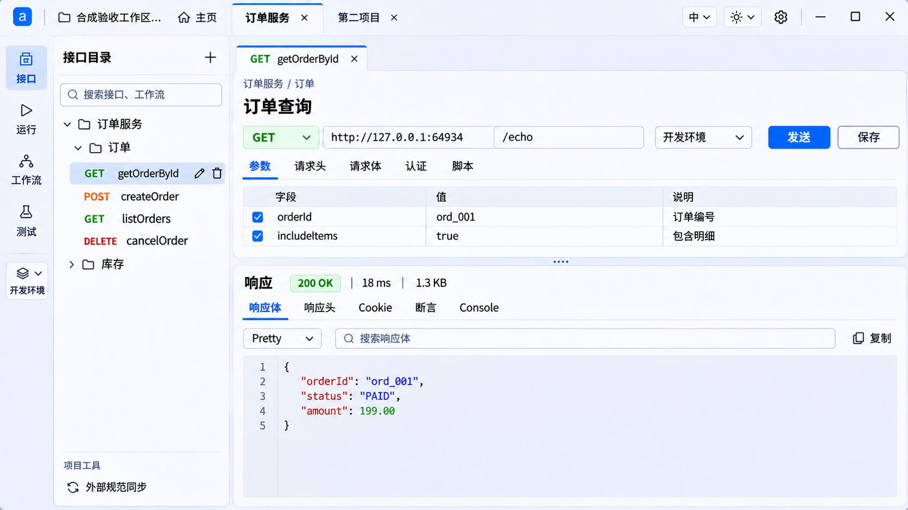

# F8 主工作台 r7 详细设计

**2026-11-13 · 已批准实施。** 基线为已交付的 P5 客户端，产品候选 `c8dc49fd`，验收归档 `1baa951c`。三批接入和源码独审已完成，实际画面、实包验证和剩余验收见 [r7 实际界面与验证记录](design/f8-frontend/r7/README.md#最终-windows-候选包)。

[上一包的真实响应页](design/f8-frontend/p5/native/04-response-200-split-scroll.png) · [P5 验证记录](f8-frontend-polish-p5-validation.md) · [页面展示规范](ui-presentation-guidelines.md)

## 1. 本次要交付的变化

真实客户端要能一眼看到四个变化。Windows 窗口顶部由主页、项目签和全局工具共用一行。左侧浅色模块栏与目录分层，同步归入项目工具。调试页用一条清楚的请求命令行突出发送。响应摘要与正文工具形成稳定的页头，短参数页把更多高度让给响应。

**功能保留规则。** 只有用户明确同意移除的功能才可删。去掉标题栏里的应用名字样、简化重复的顶部入口、压缩或搬移控件都是展示调整。项目查找与打开、连接登录和账户操作、工作区迁移和退出、请求与响应的既有能力均须保留。样板没画出的控件和状态在第 3–8 节落实到具体去向。后续发现未盘点的入口，先补入对照，按现有语义接入。若确实需要删减功能，单独交用户决定。

范围为桌面窗口、主页相关导航入口、项目侧栏和调试工作区。在线项目继续用已有编辑面板。运行、工作流、测试、环境管理通过新壳进入原页面。此次涉及的本地选择、显示和焦点状态在客户端处理，沿用已有执行、鉴权、保存、同步和安全投影契约。

### P5 实际差距与 r7 对照

| P5 实际表现 | r7 必须看见的变化 |
| --- | --- |
| 原生标题、常驻原生菜单、应用顶栏和全宽同步入口依次占行 | Windows 默认只有一行顶栏；项目同步移至左侧项目工具 |
| 项目下拉、在线按钮、语言全名及三段主题选项挤在同一排 | 项目签居中伸缩，右侧只保留紧凑的语言、主题与设置；原功能迁入第 3 节的位置 |
| 模块栏深底，点“环境”即进入管理 | 浅色模块栏与目录分层；环境触发器收起可见当前值，切换留在请求页 |
| 协议、地址、环境、执行、设置和两种保存同排溢出 | 一组地址控件、一个主发送槽、一个常规保存，细分工具有固定位置；窄宽按实际命令区折行 |
| 响应摘要在页签附加区，正文滚动可能同时带走操作 | 摘要成为独立首行，正文和详情局部滚动，能一眼区分响应状态和断言结论 |

### 设计尺寸

尺寸为 renderer 的 CSS px，原生窗口边框另外计。布局按实际可用宽度判断，系统 DPI 和应用缩放均可触发紧凑布局。

| 区域 | 常规布局 | 紧凑布局 |
| --- | --- | --- |
| 顶栏 | 高 46。左侧 28×28 应用图标，工作区标签固定 152 宽，主页固定，项目签区域伸缩，语言／主题／设置靠右 | 窗口内容宽低于 1024，标签改为固定 112。低于 760，标签固定 88、主页可缩为带名称的图标、语言与主题可收进同一个全局菜单。设置与原生窗控仍直接可达 |
| 左模块栏／目录 | 模块栏 64，目录 248。目录与编辑区分隔 1。工作区宽度优先留给编辑器 | 低于 1024 模块栏 56、目录 208。低于 900 或主编辑区宽不足 600 时可把目录收为覆盖式面板，模块入口提供明确的打开／收起动作 |
| 主区与控件 | 外边距 8、面板内边距 12、圆角 6–8。文本 13–14，接口标题 20，行高约 1.45。主按钮与地址输入高 32，目录行 32 | 主控件仍保持可操作尺寸。标签、表格和正文按自己的容器处理溢出 |
| 调试区 | 接口签 34–36，调试／设计工具行 32–36，请求与响应各为一块主要表面，分隔拖动区 10 | 短窗口可顺序滚动到两块内容，顶部主页及模块导航继续可达 |

普通正文与背景对比目标至少 4.5:1，焦点与必要的控件边界至少 3:1。焦点轮廓不改变盒子尺寸。以下为工作台局部的浅色参考色，实际接入通过主题变量映射。深色沿用现有深色表面与语义色体系，需在真实组件上单独核对。

| 表面／状态 | 浅色参考 | 使用规则 |
| --- | --- | --- |
| 应用底色／顶栏／目录 | `#EAF0F8`／`#F5F8FD`／`#F7F9FC` | 从整体底色到侧栏形成轻微明度差。模块栏也用浅底，分隔线贯穿而不围出多个小框 |
| 请求／响应面板 | `#FFFFFF`，边线 `#D7E0ED` | 两块主面板各用一层边界。工具组以间距或细分隔组织 |
| 当前项目签／目录行 | `#FFFFFF` 加顶部蓝线／`#DCE9FF` | 顶部蓝线预留高度。选中、悬停和键盘焦点各有区别，切换不改布局 |
| 主要动作／正文 | `#1557D8`／`#17243A` | 请求行发送为主色实心，保存与更多为中性。提示文字使用现有可读次级色 |
| GET／成功状态 | `#E6F5EB` 底、`#14643A` 字 | 同一语义色方向。HTTP 失败和请求终态各自呈现，选中反馈不靠绿底表达 |
| 响应正文／行号 | `#F1F5FB` 底、等宽文字与低对比细分隔 | 行号可读，代码区域高度随分隔调整。长行局部滚动 |

## 2. Windows 单行顶栏

布局顺序为 **应用图标 → 工作区标签 → 固定主页 → 项目签 → 全局工具 → 原生窗控**。P5 另有一行同步入口，新版移除这一行。错误提示按需出现，平时不占空行。

- Windows 采用 Electron `titleBarStyle: 'hidden'` 与 `titleBarOverlay`，由系统绘制最小化、最大化／还原和关闭。沿用已有应用图标和窗口身份。渲染层按实际 Window Controls Overlay 安全区域布置工具，预留随 DPI、最大化和缩放变化的窗控宽度，不能用一个固定宽度估算。留出可拖区域，所有标签、菜单和按钮均为可点击区。拖动、双击最大化、窗口边缘缩放及系统快捷键保留。
- 保留原生 File／Edit／View／Window 菜单及其动作。Windows 设计为日常收起，按 Alt 可访问，保留原加速键及系统窗口菜单。全局菜单保留“应用菜单”入口，打开同一套原生命令，供鼠标发现和操作。先在实际打包窗口验证叠加层与原生菜单的组合行为，再确认旧菜单条是否可以收起。验收需实际用键盘和鼠标访问菜单，核对复制粘贴和缩放等动作。原生菜单打开时允许临时占行。macOS、Linux 沿用现有原生窗口框架，应用内部仍只有一行顶栏。
- 关闭按钮、Alt+F4 等继续通过现有退出守卫。若 Windows 原生叠加层在约定尺寸或打包产物上无法保障菜单可达、拖动或关闭确认，阶段保留原生框架以保障使用，并把 Windows 单行验收记为未通过，交用户决定是否接受替代。
- 工作区名字是只读标签，无下拉箭头、无切换副作用。内容跟随当前查看的项目所属工作区；主页或无项目时沿用当前工作区上下文，未打开时显示简短空态。混合驻留本地 A、在线 B 时，打开 A 的项目应显示 A，不能用 B 的在线活跃指针遮掉它。名称单行省略，溢出时鼠标悬停或键盘聚焦可读完整值，屏幕阅读器始终可读全名。切换通过主页完成。
- 主页始终首签、不可关闭、在横向溢出区之外。项目签内文字单行省略，关闭位固定，草稿／离线状态有文字或可读描述。沿用现有激活、左右键、Home／End、关签确认及状态恢复。签太多时只滚项目签，切换后让选中签进入视口。空间不足时提供已有滚动箭头，极窄时可在项目列表选中任一已开签，避免点不到关闭位或当前签。
- 语言触发器显示 `中` 或 `EN` 加短箭头，菜单显示“中文”“English”和选中标记；主题触发器用屏幕／太阳／月亮图标表示自动／浅色／深色，悬停或可访问名称明确当前值。选择后即时生效、关闭并回焦，重启沿用现有偏好键。自动模式让渲染层主题变量、组件主题和原生窗控保持一致。需核对启动与系统主题实时变化，不能用切换成深色代替自动模式验收。
- 设置仍是可见齿轮，沿用应用设置、插件、AI 配置、在线执行缓存、本地项目网络及原有上下文门控。工作区问题计数保留为图标加数字与可读提示，信息和错误原入口可达。全局菜单在宽布局保留小图标入口，窄布局也承接语言和主题。弹层打开、退出、回焦见第 9 节。

## 3. 顶栏与主页入口迁移对照

| 现有入口 | r7 位置和行为 | 保留的边界 |
| --- | --- | --- |
| 顶部项目下拉 | 打开项目移到“主页 → 本地项目列表”。项目列表头提供名称筛选，进入后可查当前工作区的全部项目；按分组查看沿用原卡片。已开项目直接点顶栏签 | 同名项目在全工作区结果中显示分组，传完整 `ProjectLocator`，不用显示名或裸 ID 选项目；查找不自动打开，不写项目 |
| 顶部“在线模式” | “主页 → 管理连接”中选定连接再登录／管理账户。“主页 → 服务器”保留浏览和登录。当前在线项目也可从项目工具进入对应连接 | 保留登录、账号状态、退出登录和浏览。新增／编辑／删除连接仍在同一管理页，调用现有处理。零连接时从空态新增，不弹无归属登录框 |
| 顶部“迁移”“退出在线工作区” | 放到主页服务器下当前在线工作区行的“工作区操作”菜单。当前在线项目的项目工具也可进入同一动作 | “退出工作区”与“退出登录”仍是不同动作。迁移沿用原向导。退出工作区沿用影响确认、列出项目签／草稿、关闭对应工作区会话。确认前锁定目标身份，活动目标变化时重新确认，取消不提交 |
| 工作区名称／打开目录 | 顶部为名称标签；“主页 → 本地”保留现有打开／新建工作区和目录选择；在线工作区仍由主页服务器列表打开 | 本地与在线驻留并存，往返主页不释放工作区或清草稿；保留已有不允许切换或需确认的边界 |
| 首页创建、管理项目和分组 | 保留主页项目卡片与其现有操作，包括新建、导入、重命名、移动、克隆和删除等按当前类型可用的能力 | 沿用只读／确认／项目定位，筛选空态可清除；卡片、分组和侧树之间不改身份 |
| 设置、全局语言／主题、系统菜单 | 同行的紧凑触发器，窄宽全局菜单承接语言／主题；原生菜单仍由系统快捷入口访问 | 只有一套活跃控件，语言与主题复用同一偏好；已打开的弹层不会因缩放而遗留焦点 |

在线断开或登录失效仍在原位置显示原因及可用的重新连接入口。只通过选定连接启用登录。登录框关闭／重开、地址编辑和退出确认延续已有连接归属与草稿规则，不以切换视觉状态模拟登录成功。

## 4. 左侧导航、接口目录和项目工具

### 模块与目录

- 纵向顺序为接口、运行、工作流、测试，环境位于下方独立区域。主页使用原主页布局。模块项上图标、下名称，当前模块显示浅底和图标强调，保持当前选择的可访问语义。在线模式继续按 `viewSwitch.ts` 的既有门控，在线侧树保留。不能通过紧凑菜单绕过门控。
- 接口目录首行是标题与新建“＋”，搜索单独一行，保留按接口和工作流名称筛选、清除回焦、展开和无结果反馈。新建菜单根据当前目标列出原先允许的新建动作：在项目下新建模块，在模块／目录下新建接口或目录。工作区根级的新建分组及项目级管理仍可在已有位置访问。
- 树的目录主体独立纵向滚动。模块、目录、项目、接口、工作流继续用既有数据和识别方式，层级缩进、状态点和 HTTP 方法标签各自有位置。长名称单行省略，鼠标悬停／焦点可查全名。保持过滤、展开和选中状态的既有项目记忆。
- 接口固定两个 28×28 位置（重命名、删除），模块和目录三个（更多、重命名、删除），可编辑的其他项目树节点对应既有动作，仍有唯一明确入口。宽布局选中、悬停或键盘聚焦时显示图标，普通行预留同样宽度。文字说明只在图标悬停／聚焦的提示显示；进入、退出、打开菜单时行的高宽与文字末端均不动。极窄深层节点可用固定“更多”槽收纳全部动作。无悬停设备仍能点击这些动作。
- 重命名、删除、管理和创建不触发行选中或展开。删除保持原目标名称与二次确认，取消和成功后回到树内合理位置。只读或在线浏览节点不暴露不可用的写入口。保持工作流重命名／删除走自身处理器。

### 项目工具

“外部规范同步”主入口在目录底部“项目工具”，不随长树卷走。运行、工作流、测试、环境等未显示接口目录的场景，以及目录收起或短高无足够空间时，由模块栏底部“项目工具”菜单提供同一个入口。任一布局同时只提供一个主要位置。没有有效 `syncScope` 时不呈现项目同步操作。

点入口仍打开现有 SyncPanel，继续显示本地／在线能力与只读状态。项目工具只携带当前项目身份。切项目时先关闭上一项目的同步面板，再按既有机制激活新作用域；重新打开需用户显式点击。这样不会把旧候选、源配置或审批画到新项目。关闭面板按现有行为停前台轮询；后台定时、在途及对账仍由原逻辑处理。关闭后回焦到入口，入口因切换失效时落到新项目签。短窗口能滚到操作和关闭按钮。

当前 `App.vue` 只在作用域变为 null 时关面板，此处需补齐 A → B 均有效的切换场景，用完整作用域判断。

在线项目的项目工具增加“连接与账户”“迁移在线工作区”“退出在线工作区”，以菜单项形式出现。即使当前项目缺少同步执行上下文，只要原连接与工作区操作适用，项目工具仍可显示。连接与账户使用选中项目关联的连接，不能用本地工作区旁仍驻留的另一账户代替。

## 5. 环境快捷选择

| 所在场景 | 左侧触发器和菜单 | 选择的影响 |
| --- | --- | --- |
| 本地接口调试，当前有匹配的请求签 | 收起显示图标、短箭头和当前名称；菜单第一项“无环境”，后面是当前项目的环境，选中项带勾；最后分隔出“管理环境” | 改当前请求签的 `selectedEnvironmentId`，请求行的选择器同步。下一次请求用既有环境 ID 和凭据上下文；已发出的调用仍用启动时快照 |
| 调试旧入口，没有请求签但有有效本地编辑会话 | 使用原选择器的可用环境和当前值 | 沿用现有 legacy `debug.selectedEnvName` 及回写。不得创建新的全局环境状态 |
| 本地设计／运行／工作流／测试，无可选调试请求，或没有项目 | 左侧显示“环境”或管理入口；适用时提示“选择一个调试请求后可切换环境”。管理入口使用原模块门控 | 运行、工作流、测试、压测保留各自环境选择；不从左侧调试选择隐式修改计划、变量、项目默认环境或既有任务 |
| 在线项目 | 沿用当前在线模块门控与现有在线环境操作 | 不复用本地环境 ID，也不更改在线代理或执行范围 |

- 两处选择器用同一选项与选择动作。签存在时绑定 root、完整项目定位、请求签及代次，区分同名环境，避免先切签再点旧弹层把选择写给新签。菜单外侧位于目录上方，窄窗／短窗可翻转定位并内部滚动。切项目、切请求签或退出调试时关闭弹层。
- 名称长时始终显示一行省略，完整名称在提示和可访问名称内。零个环境时“无环境”仍是合法选项。加载中保留当前值或清楚提示正在加载；如果选中的环境已被删除，显示“环境已不可用，请重新选择”，不悄悄按“无环境”发送。主动选择“无环境”后才清空。名单及权限仍由原项目来源读取，选择本身不会保存契约或写环境配置。
- 只读项目维持当前调试环境选择能力；环境管理的增删改仍按原只读规则。选环境成功后留在原编辑页，不触发请求、不清正文草稿，也不因点菜单引发不必要的刷新。切签回来恢复该签的选择。用键盘打开菜单、上下移动、Enter 确认、Esc 回焦。点“管理环境”沿用进入 EnvPanel 的原模块切换及离开保护。

## 6. 请求编辑与发送

### 可见布局

1. 保留请求签（接口签、自由请求、新建请求、关闭和草稿提示）。下一行是“调试／设计”与接口工具，桌面宽度充足时显示调试历史、导入，AI 建议和管理模型可在同一工具组。紧凑宽度将低频工具合入带名称的菜单，所有入口仍可使用。导入仍打开当前模块向导，历史仍能选择原上下文的结果。
2. 请求面板起始显示已有项目／模块／目录面包屑与接口名称。长路径单行省略，可查完整路径；重名依据真实定位。保留名称、说明、标签、版本、状态和未保存提示。元数据移入同面板的“接口详情”，标题旁可查看／编辑，展开后为表单。错误、校验和脏状态不能只放在折叠区。自由请求显示自身名称或既有类型，不伪造接口目录。
3. 主命令行固定顺序为 **协议／方法与地址 → 环境 → 发送位置 → 保存 → 更多请求操作**。HTTP 方法是低饱和的小控件；方法、服务地址、路径用一组细分隔，不把 URL 和路径合并为新字段。HTTP 自由请求保留完整 URL 输入和非法地址反馈；WebSocket 使用原地址与消息，SOAP 保留原固定 POST、Envelope 和 SOAPAction。协议下拉保留三种协议和原切换处理器，当前协议可见，切回各协议恢复现有草稿。
4. 用例选择保留在调试工具内，选择态可读，窄布局可落到请求面板第二行。请求更多操作包含“保存请求”、调试设置和从本机调试历史选择单项分享。“保存”与“保存请求”继续走原两条保存链，后者只保存请求范围，菜单文案和提示解释范围。自由请求的主保存为“另存为接口”，保留落点／新建模块、校验和确认。发送旁常规“保存”用中性描边。只读、恢复字段未补齐、非法 URL 等按既有行为阻挡，不因控件搬移失效。
5. 正文区用实际的路径参数、查询参数、请求头、Cookie、认证、请求体／消息／Envelope 页签。样板中的“参数”对应当前查询参数示例，“脚本”对应测试模块内用例脚本入口；测试仍可进入原编辑器，调试面板不新造脚本作用域。接口定义关联的 Schema、响应契约、项目资产、Mock、凭据与 OAuth 管理继续可达，按各自已有内容放在请求表单下对应具名分区；不随简化视觉消失。
6. 常见参数行用“启用／字段／值／说明／操作”紧凑列展示，主行约 32 高。必填、Schema 和组件绑定用同行的详情按钮展开可读表单；组件引用仍显示真实绑定和缺失状态。新增行、移除行、引用编辑和原验证条件均保留。窄时详情落到下一行，长文本在局部控件滚动。两行参数之后保留约 12–16 内边距，不用固定大块空白填满面板。

命令区有足够宽度时保持单排。可用宽度低于约 760 时，协议与地址留在第一排，环境、发送、保存和更多组成第二排；用例跟随第二排，空间不足时用具名工具入口承接。第二排保持发送与保存相邻。最窄时地址与路径可在该组内部上下布局，仍能看出两者归属；发起动作不随正文滚动移走。此处以实际容器宽度为准，窗口整体宽度只用于外壳。

### 发送与取消同位

| 请求状态 | 固定发送槽 | 交互条件 |
| --- | --- | --- |
| 就绪 | 实心主操作“发送” | 用既有请求／自由请求链；缺必需字段时禁用或用原校验解释 |
| 已开始，尚无可取消的运行 ID | “发送中…”并显示忙碌 | 禁止再发送；不显示一个无法工作的取消按钮 |
| 运行 ID 可取消 | 同一槽内显示“取消请求” | 调用已有取消回调及当前签的 runId。收到终态前保持忙碌；取消提交期间防重复点击 |
| 成功／失败／已取消／取消未确认 | 在可安全再次发送时恢复“发送”；结果区显示实际状态 | 取消失败或未确认继续按真实运行状态与原错误反馈展示，不伪造已取消。不会自动重试 |

发送槽宽按中英文最长常用文案预留，取消出现时不挤动环境或保存。替换时若焦点正在槽内，仍留在同一位置；用户已移到别处时不抢回焦点。状态通过局部可访问反馈播报。用例选择、保存与调试设置沿用各自的原门控，不借发送忙碌状态扩大权限。

## 7. 请求与响应分隔、响应阅读

### 分隔与短窗口

分隔条位于两块主要面板之间，视觉为细线和居中的短抓手。实际命中区 10 px。普通窗口按调试区可用高度分配，响应默认约 **54%**（P5 为 40%），目标在 1440×900、两行查询参数场景下，响应正文有至少 180 px 可见高度。请求面板若内容较多只滚其内容区，不挤掉响应。常规最小高度请求 184、响应 192，响应占比范围取现有 20%–70% 与两块最低高度约束的交集。参考高度以分隔器实际管理的区域为准，剔除上方接口工具和分隔条。

拖动向上增加响应高度、向下增加请求高度，指针移出抓手仍有效，释放、取消捕获、切页或失焦均结束拖动。键盘可聚焦分隔条，上／下每次改 5 个百分点，Home／End 到可用上下限，Enter 或双击复位至新版默认值。可访问名称描述方向和当前比例，缩放或窗口变化时重新夹取。沿用窗口内布局状态，默认比例及拖动不写项目、不跨重启持久化。

两块最小内容无法同时容纳时（调试区高度低于 400），在主区以内切为纵向顺序滚动，请求与响应完整保留；提供“转到响应／返回请求”的键盘可达定位，临时停用比例调整，恢复高度后继续使用此前比例。工具菜单和对话框可内部滚动，测试发送、取消、正文工具与关闭按钮的实际可达性。不会为了短高隐藏只在该处可用的入口。

### 响应区域

- 第一行“响应”，随后是当前交换的 HTTP 状态、耗时和正文大小。成功低饱和绿色、重定向中性蓝、4xx 警示、5xx 红色。状态用真实数字或有来源的文字，未采集说明原因。样板的 `200 OK` 在当前只提供数值的数据路径可显示 `HTTP 200`，避免将本地标签冒充真实响应短语。耗时继续使用实际毫秒，大小用真实字节计算，可短显 KiB、提示保留完整 B，真实零与未采集分开。
- HTTP 响应状态与断言／用例结论同时显示，不能用 200 覆盖断言失败。沿用交换切换、旧结果格式、用例名、错误阶段、终态和证据详情。忙碌、无结果、取消、超时、传输失败、正文未采集／被截断各有相应文字。没有 HTTP 状态时不显示虚构徽标。若原运行保留上一次结果，明确标记“上次响应”，本轮完成后再替换。
- 第二行保留交换、请求、响应体、响应头、Cookie、断言和 Console。页签过宽时只在这行横向滚动或用溢出入口。响应体第三行保留 Pretty／Raw、字面搜索、匹配计数、一键清除、复制、下载安全投影。窄宽优先保留搜索与复制，下载等通过具名更多菜单；清除立即回搜索框，原格式和结果身份保持。其它结果页签继续显示原内容和工具。
- 在常规布局，摘要、结果页签、当前工具栏在正文滚动时始终可用。正文区单独纵／横滚，证据详情和长错误不挤坏固定头；必要时在摘要展示可读关键原因并链接到局部详情。短窗口顺序滚动时仍可用定位到工具，不能叠住正文。沿用每个请求签已有的请求面板／响应面板／滚动记忆，将恢复点绑到实际滚动容器，避免写到其他签。新运行或换交换时按真实结果重定位。
- 正文使用等宽字和细分隔行号。Pretty 下的小型 JSON 使用浅／深可读的键、字符串、数字颜色。建议高亮限 64 KiB、1000 行之内，超限或格式无法识别沿用现有纯文本显示，投影已有的截断和保留策略仍有效。行号是独立呈现，不混入文本选择、搜索、复制和导出。使用安全文本渲染；HTML／脚本字符串不得被执行。不改变原 Raw、Pretty、XML 回退、二进制预览或复制／下载的安全投影内容。
- 配置、摘要、状态、执行事实继续用结构化文本或表格。API 原始请求／响应正文、契约和 Schema 仍可原样显示。长元数据、来源、计数与失败原因使用各自的标签，原始详情可折叠，不能用 JSON 块代替主要信息。

## 8. 接入边界与分批建议

本节用于评估范围与验证成本。用户确认设计后再排实施顺序。

| 建议批次 | 主要接入点 | 当批应可独立验收 |
| --- | --- | --- |
| 1. 窗口、顶栏、主页 | `main/main.ts`，`TopBar.vue`、`ProjectTabs.vue`、`ThemeLanguageToggle.vue`、`HomeView.vue`、`ConnectionPanel.vue` 和组合根 | Windows 单行、原生菜单和退出保护。所有移走的主页／在线入口先接通，再撤旧顶部位置。深浅色与窄窗 |
| 2. 左栏、项目工具与环境 | `App.vue`、`ModuleRail.vue`、`SideTree.vue`、`RequestEditor.vue`、现有 EnvPanel 和同步面板 | 目录长名和固定动作、同一项目同步入口、环境双向同步与请求／项目隔离。在线门控 |
| 3. 调试与响应 | `RequestTabs.vue`、`App.vue`、`RequestEditor.vue`、`ResponseViewer.vue`，必要时在对应组件内收纳详情 | 协议、运行、保存、请求与结果工具完整。实际首屏、拖动、搜索常驻、异常及安全正文 |
| 4. 同条件原生验收 | 同一基线包与候选包，归档真实截图、行为记录、候选提交和包标识 | 按第 10 节逐点对照，集中检查跨批入口和状态，再供用户实看 |

接入时优先复用现有组件、全定位和 store。渲染层展示主题与窗控若需要 IPC，只允许传已定义的主题偏好或 resolved light／dark，沿用宿主调用边界，不暴露通用窗口操作。环境选择用原有请求签状态；同步用原 `syncScope` 和能力检查。保留已有 `tabId`／代次与运行 ID 所有权。请求、凭据、安全存储、业务 API、数据结构与打包身份无迁移需求。

## 9. 键盘、窄宽与文本规则

- 主页、项目签、目录、请求控件、响应工具按视觉顺序进入键盘焦点。菜单支持键盘打开、方向键和 Esc；鼠标点击外部关闭。关闭后优先回触发器，触发器随切页消失则回当前项目签或对应区域标题。不用不可见控件截获键盘。
- 悬停提示与可见标签双语，用户自定义名称、路径、HTTP 方法、日志正文不自动翻译。交互按钮、下拉和图标有可读名称。状态不用颜色单独表达。支持缩放、键盘、系统高对比和减少动画偏好。
- 长名字固定盒子、截断可查；输入值用本身的滚动行为。布局变化按容器宽度重新计算，窄窗不靠把整个界面缩小或横向滚动页面。覆盖式目录在同一项目内保留原位置、搜索和展开，Esc 关闭回到模块按钮。各处需要的功能在任一布局有唯一可操作入口。
- 页面主区、目录、请求表单、结果和弹层各有明确滚动范围。极短视口弹层锚定可见区域，可移动或滚到尾部操作。遮挡、越界、重叠、表头逐字换行均记为实际缺陷。

## 10. 验收与归档

以下各项均待实现和实测。标记通过时每项要有真实结果和对应证据。视觉不通过的项单独列出，不能用其行为测试通过冲销。

| 项 | 通过条件 | 证据 |
| --- | --- | --- |
| V09.1 顶栏 | Windows 默认只有一行；样板顺序成立。长工作区全名可查，主页固定，签过多仍可切换和关闭。原生菜单、窗控、拖动、缩放和未保存退出可用 | 同尺寸整窗前后图；原生操作记录。页签与主题的受影响定向测试 |
| V09.2 入口保留 | 第 3、4、6、7 节原入口逐项可达，至少实走同名项目查找、连接登录／账户／退出、在线迁移与工作区退出取消、两类保存及响应下载。门控保持 | 记录旧入口、新位置、原处理器和实际结果。附定向测试与合成项目记录 |
| V09.3 左栏与目录 | 浅色导向及层次可见。长接口、模块、目录悬停前后实际尺寸与文本截断点一致，键盘能用具名动作。同步无全局独立行，切项目旧面板不漂移 | 实际组件宽窄截图，树行几何记录，打开、取消、切项目行为 |
| V09.4 环境 | 两个入口未展开时显示同一个当前值；两处互改，切请求签／跨项目恢复各自选择。删除当前项、只读、无项目、在线门控、回焦均有明确结果。发送使用所选环境，不修改已运行任务 | 同名环境合成夹具，调用参数或回环服务记录。环境菜单打开／关闭真实图 |
| V09.5 请求 | HTTP、自由请求、WebSocket、SOAP 的入口和编辑结构完整。宽窗地址、环境与执行同排，两行参数后的内留白约 12–16 px。发送／取消同槽，200／503／取消和原保存生效 | 截图或录屏、调用日志与磁盘重开。运行编辑、保存和调试的受影响测试 |
| V09.6 响应 | 摘要、页签、搜索常驻，长正文仅在内容区滚。宽窗默认响应正文可见高度达到第 7 节目标。分隔实际可拖并可用键盘，双击复位。Raw／Pretty、搜索、复制和安全下载结果对应当前交换。失败与无响应可读 | 原生拖动的实际高度变化、滚动前后图、原始／安全投影对照。工具拖动失败不得记为产品通过 |
| V09.7 布局和主题 | 中文浅色正常宽度、英文深色窄窗、应用放大、短窗口均可操作。自动主题实测系统变化与控件一致 | 原生及实际组件照片与尺寸。记录系统缩放／主题和应用缩放，列出仍未验证的平台 |

**前后对照。** 用 P5 基线和候选 Windows 包打开同一合成项目副本、相同接口和结果。主对照为同一窗口外框尺寸（目标 1440×900）、中文浅色、应用缩放 100%，包含长工作区名、至少两个项目签、长接口名、两行查询参数、已选择环境和长响应。固定外框才能看到单行顶栏实际回收的高度，同时记录 renderer 内容尺寸。追加 960×720 英文深色、约 640 px 窄宽、约 280–320 px 短高和原生应用放大。若系统达不到目标宽高，使用可达尺寸配对并记录差异。截图保留完整窗口和当前状态。额外记录顶部常驻行数、主工作区可用宽高、请求命令区行数、短参数区尾部留白、默认响应正文可见高度和分隔拖动前后高度。常规宽度截图应能直接看出标题栏、目录、请求命令行和响应结构已改变。

**记录位置。** 设计、验收和工作日志归档在 `docs/`。实际图、交互回执和候选包标识计划存放 `docs/design/f8-frontend/r7/`，详细原始运行日志和候选 ZIP 放在 `local/f8-frontend-r7/`。实现后填入每项测试入口、实际结果与证据路径，保留失败及复验历史。定向验证从 `topBar.test.ts`、`projectTabs.test.ts`、`ThemeLanguageToggle.test.ts`、`moduleRail.test.ts`、`App.test.ts`、`components.test.ts`、`stores/debug.test.ts` 等选择具体用例。产品截图与样板分开归档。提交、集成和完整本地门禁遵循项目约定，按当次授权执行。
